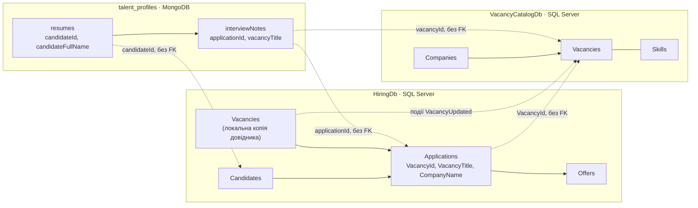
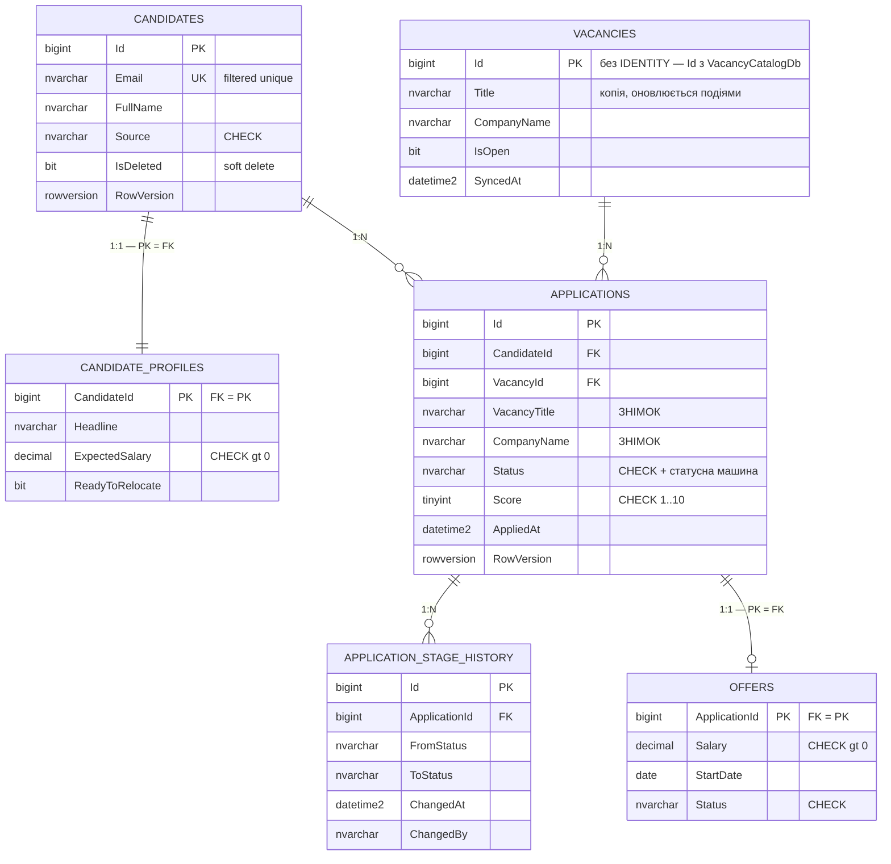
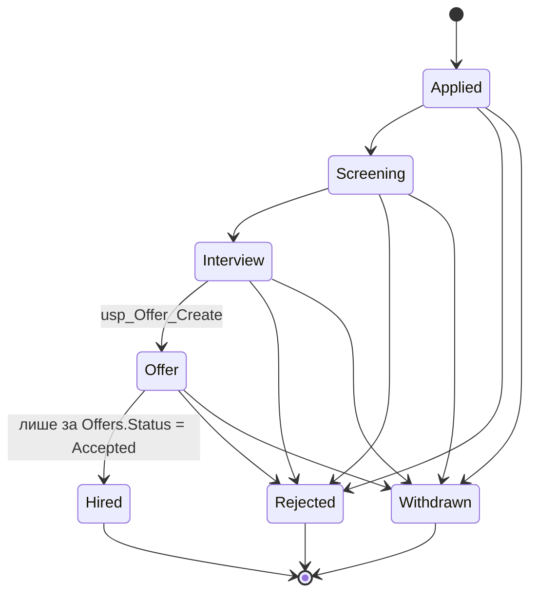
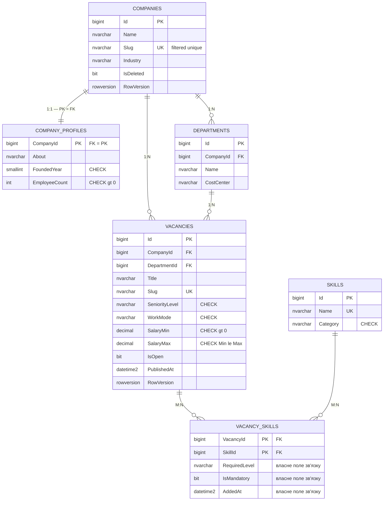

# Практичне заняття №1 — Проєктування та розробка баз даних для мікросервісної архітектури

**Предметна область:** рекрутингова платформа (найм персоналу)
**Стек:** SQL Server 2022 (Docker) × 2 бази + MongoDB 7 (Docker) × 1 база

---

## 1. Опис предметної області та межі контекстів

### 1.1. Домен

Платформа для рекрутингових агенцій і HR-відділів. Компанії публікують вакансії з переліком потрібних навичок, кандидати подають на них заявки, а рекрутери проводять ці заявки через етапи відбору — від первинного скринінгу до офера й найму. Окремо система зберігає резюме кандидатів, нотатки інтерв'юерів і результати тестових завдань, структура яких суттєво різниться від кандидата до кандидата.

### 1.2. Три обмежені контексти (Bounded Contexts)

| № | Контекст | База даних | Технологія | Чому саме так |
|---|---|---|---|---|
| 1 | **Hiring** — процес найму | `HiringDb` (SQL Server) | ADO.NET & Dapper | Заявка — транзакційний процес зі строгою статусною машиною. Потрібні явні транзакції, блокування рядка й збережувані процедури, які відмовляють на недопустимому переході. |
| 2 | **Vacancy Catalog** — довідник вакансій | `VacancyCatalogDb` (SQL Server) | EF Core (Code First) | Багато сутностей і всі типи зв'язків, довідникові дані, часта зміна структури → Fluent API, seed, міграції. |
| 3 | **Talent Profiles** — профілі кандидатів | `talent_profiles` (MongoDB) | MongoDB-драйвер | Резюме, нотатки й тестові завдання мають динамічну структуру: у когось є публікації, у когось портфоліо, у когось лише три поля. Документна модель із піддокументами підходить природно. |

### 1.3. Розподіл сутностей (кожна належить рівно одному контексту)

| Контекст | «Свої» сутності (власник даних) | Знає про чуже лише за Id |
|---|---|---|
| **Hiring** | `Candidates`, `CandidateProfiles`, `Applications`, `ApplicationStageHistory`, `Offers`, `ApplicationStatusTransitions` | `VacancyId` (+ локальна копія довідника `Vacancies`) |
| **Vacancy Catalog** | `Companies`, `CompanyProfiles`, `Departments`, `Skills`, `Vacancies`, `VacancySkills` | — (нічого чужого не зберігає) |
| **Talent Profiles** | `resumes`, `interviewNotes`, `assessments`, `talentPools` | `candidateId`, `applicationId` (Hiring), `vacancyId` (Catalog) |

### 1.4. Схема взаємодії між базами



Суцільні стрілки — звичайні `FOREIGN KEY` **усередині однієї бази**. Пунктир — **логічне посилання за ідентифікатором між базами**, без будь-яких FK; цілісність такого посилання за потреби перевіряє прикладний код.

---

## 2. Агрегати й межі даних

| Контекст | Агрегат | Корінь | Що входить | Життєвий цикл |
|---|---|---|---|---|
| Hiring | Кандидат | `Candidates` | `CandidateProfiles` | Профіль не існує без кандидата, змінюється лише разом із ним (`ON DELETE CASCADE`). |
| Hiring | Заявка | `Applications` | `ApplicationStageHistory`, `Offers` | Історія етапів і офер не існують без заявки й змінюються лише через неї — усі зміни проходять через процедури. |
| Vacancy Catalog | Компанія | `Companies` | `CompanyProfiles`, `Departments` | Профіль і відділи живуть разом із компанією. |
| Vacancy Catalog | Вакансія | `Vacancies` | `VacancySkills` | Вимоги до навичок змінюються лише через вакансію. Видалення вакансії каскадно знімає її вимоги, але **не** чіпає довідник `Skills`. |
| Talent Profiles | Резюме | `resumes` | вбудовані `contact`, `experience[]`, `education[]`, `skills[]` | Завжди читаються разом із резюме → embedding. |
| Talent Profiles | Нотатка інтерв'ю | `interviewNotes` | вбудовані `interviewer`, `scores`, `comments[]` | Коментарі короткі й обмежені за кількістю → embedding. |
| Talent Profiles | Пул талантів | `talentPools` | масив `resumeIds[]` | Може містити тисячі резюме, резюме живуть власним життям → referencing. |

---

## 3. Таблиця політики дублювання даних

Мінімум один рядок на кожну пару контекстів, що взаємодіють.

| Поле | Де зберігається | Джерело (власник даних) | Політика узгодженості |
|---|---|---|---|
| `Applications.VacancyTitle`, `Applications.CompanyName` | HiringDb (SQL) | `Vacancies` (VacancyCatalogDb) | **Знімок** на момент подання заявки — не оновлюється ніколи. Історія найму має показувати назву, на яку кандидат реально подавався. |
| `Vacancies.Title`, `CompanyName`, `DepartmentName`, `IsOpen` (локальна копія довідника) | HiringDb (SQL) | `Vacancies` (VacancyCatalogDb) | **Копія для читання** — оновлюється подіями `VacancyPublished` / `VacancyUpdated` / `VacancyClosed` (механізм — Лаб. 08). Колонка `SyncedAt` фіксує момент останньої синхронізації. |
| `resumes.candidateFullName`, `resumes.candidateEmail` | MongoDB | `Candidates` (HiringDb) | **Копія для читання** — оновлюється подією `CandidateUpdated`. Потрібна, щоб показати список резюме без синхронного виклику сервісу Hiring. |
| `interviewNotes.vacancyTitle` | MongoDB | `Vacancies` (VacancyCatalogDb) | **Копія для читання** — оновлюється подією `VacancyUpdated`. Дозволяє будувати аналітику по вакансіях цілком усередині MongoDB. |
| `assessments.candidateId`, `assessments.vacancyId` | MongoDB | `Candidates` (HiringDb), `Vacancies` (VacancyCatalogDb) | Лише **ідентифікатор**, жодних дубльованих атрибутів. Жодного FK. |
| `interviewNotes.applicationId` | MongoDB | `Applications` (HiringDb) | Лише **ідентифікатор**. Коректність посилання перевіряє прикладний код. |

**Dual write відсутній:** кожне дубльоване поле має рівно одного власника, інші сервіси його тільки читають. Жодне поле не редагується незалежно у двох базах.

---

## 4. ERD

Повні джерела діаграм — у папці `erd/` у форматі **DBML**. Щоб отримати картинку: відкрити <https://dbdiagram.io> → *New Diagram* → вставити вміст `.dbml`-файлу → *Export* → PNG (або *Share* для посилання).

### 4.1. Проєкт №1 — HiringDb



Таблиця `APPLICATIONS` одночасно є **проміжною таблицею зв'язку M:N** між `CANDIDATES` і `VACANCIES` — має два зовнішні ключі та власні поля (`Status`, `Score`, `AppliedAt`, знімки).

Окремо існує таблиця-довідник `ApplicationStatusTransitions (FromStatus, ToStatus)` — статусна машина, винесена в дані.

### 4.2. Статусна машина заявки



### 4.3. Проєкт №2 — VacancyCatalogDb



---

## 5. Обґрунтування проєктних рішень

### 5.1. Вибір первинних ключів

Скрізь використано **`BIGINT IDENTITY(1,1)`**, а не GUID. Обґрунтування: ідентифікатори генеруються в одному місці — самою базою конкретного сервісу; вставка послідовна, тому кластеризований індекс не фрагментується; ключ займає 8 байт замість 16, що важливо, бо він повторюється в кожному некластеризованому індексі.

Виняток, де GUID був би доречнішим: якби Id генерувалися на клієнті або в кількох вузлах одночасно (офлайн-режим, мультимастер-реплікація, злиття баз) — тоді послідовність втрачає сенс, а ризик колізії стає визначальним.

`HiringDb.dbo.Vacancies.Id` навмисно **без `IDENTITY`**: це локальна копія довідника, її ідентифікатори приходять ззовні, з бази Каталогу.

### 5.2. Каскади — усвідомлено

| Зв'язок | Поведінка | Чому |
|---|---|---|
| `Candidates → CandidateProfiles` | CASCADE | Профіль не має сенсу без кандидата. |
| `Applications → ApplicationStageHistory` | CASCADE | Історія належить заявці. |
| `Applications → Offers` | CASCADE | Офер належить заявці. |
| `Candidates → Applications` | NO ACTION | Кандидата з історією заявок не можна «тихо» знести разом із нею. |
| `Companies → Vacancies` | NO ACTION | Видалення компанії не повинно знищити вакансії, на які вже подалися люди (заодно уникаємо помилки *multiple cascade paths*). |
| `Skills → VacancySkills` | NO ACTION | Довідник навичок не має зникати разом із вакансією. |

### 5.3. Аудит, м'яке видалення, конкурентність

Усі змінювані таблиці мають `CreatedAt`, `CreatedBy`, `UpdatedAt`, `UpdatedBy`, `IsDeleted` та `RowVersion` (`ROWVERSION`).

`RowVersion` потрібен там, де один рядок можуть паралельно редагувати двоє: заявку одночасно відкривають рекрутер і HR-директор. Оптимістична конкурентність не блокує читання, але не дає другому користувачеві «тихо» затерти зміни першого — `UPDATE ... WHERE Id = @id AND RowVersion = @originalRowVersion` оновить 0 рядків, і застосунок покаже конфлікт. У Лаб. 03 EF Core використає це поле автоматично через `IsRowVersion()`.

`IsDeleted` ламає звичайний `UNIQUE`, тому всі унікальні обмеження реалізовано **фільтрованими унікальними індексами** з предикатом `WHERE IsDeleted = 0`.

---

## 6. Розгортання з нуля

### 6.1. Передумови

* **Docker Desktop** (на Windows — з увімкненим WSL2)
* **VS Code** + розширення `SQL Server (mssql)` та `MongoDB for VS Code`

Нічого іншого встановлювати не треба: ані SQL Server, ані MongoDB, ані SSMS, ані `mongosh`. .NET SDK у цій роботі не потрібен.

### 6.2. Крок 1 — підняти контейнери

```bash
docker compose up -d
docker compose ps        # обидва контейнери мають бути в стані running
```

Перший запуск триває 1–3 хвилини: Docker завантажує образи. SQL Server готовий приймати підключення приблизно через 30 секунд після старту.

### 6.3. Крок 2 — підключитися з VS Code

**SQL Server** (`Ctrl+Shift+P` → *MS SQL: Connect*):

| Параметр | Значення |
|---|---|
| Server | `localhost,1433` |
| Authentication | SQL Login |
| User | `sa` |
| Password | `Lab01_Str0ng!Pass` |
| Encrypt | Mandatory |
| **Trust server certificate** | **Yes** ← без цього підключення не відбудеться |

**MongoDB** (іконка листка на бічній панелі → *Add Connection*): рядок підключення `mongodb://localhost:27017`.

### 6.4. Крок 3 — виконати скрипти по порядку

Бази автономні, тому технічно порядок не важливий. Логічно зручніше починати з Каталогу — він власник ідентифікаторів вакансій, які далі з'являються в локальній копії HiringDb.

| № | Файл | Що робить |
|---|---|---|
| 1 | `project2-vacancy-catalog/schema.sql` | створює `VacancyCatalogDb`, 6 таблиць, індекси, view, логін `catalog_app` |
| 2 | `project2-vacancy-catalog/seed.sql` | 3 компанії, 8 відділів, 20 навичок, 8 вакансій, 29 зв'язків M:N + перевірки |
| 3 | `project1-hiring/schema.sql` | створює `HiringDb`, 7 таблиць, індекси, view, логін `hiring_app` |
| 4 | `project1-hiring/procedures.sql` | 6 збережуваних процедур |
| 5 | `project1-hiring/seed.sql` | статусна машина, локальна копія довідника, 8 кандидатів, 8 заявок + перевірки |
| 6 | `project3-talent-profiles/talent-profiles.mongodb.js` | колекції, валідатори, індекси, 17 документів, запити й агрегації |

Для `.sql` — відкрити файл, обрати підключення у правому верхньому куті, натиснути **Execute Query** (`Ctrl+Shift+E`).
Для `.mongodb.js` — відкрити файл і натиснути **Run All** (або виділити блок і *Run Selected*).

### 6.5. Альтернатива — без VS Code, через `docker exec`

Папка проєкту змонтована в контейнер як `/scripts`:

```bash
P='Lab01_Str0ng!Pass'
S='/opt/mssql-tools18/bin/sqlcmd -S localhost -U sa -C -P'

docker exec -i lab01-mssql $S "$P" -i /scripts/project2-vacancy-catalog/schema.sql
docker exec -i lab01-mssql $S "$P" -i /scripts/project2-vacancy-catalog/seed.sql
docker exec -i lab01-mssql $S "$P" -i /scripts/project1-hiring/schema.sql
docker exec -i lab01-mssql $S "$P" -i /scripts/project1-hiring/procedures.sql
docker exec -i lab01-mssql $S "$P" -i /scripts/project1-hiring/seed.sql

docker exec -i lab01-mongo mongosh --quiet < project3-talent-profiles/talent-profiles.mongodb.js
```

*(Якщо `sqlcmd` не знайдено — перевірте шлях: `docker exec lab01-mssql ls /opt | grep mssql-tools`.)*

### 6.6. Повторний запуск

Усі три seed-скрипти **ідемпотентні**: запустіть їх двічі поспіль — кількість рядків і документів не зміниться. Механізми:

* SQL: `INSERT ... WHERE NOT EXISTS` за явним `Id`; `usp_Candidate_Upsert` шукає за `Email` перед вставкою; блок побудови воронки виконується лише якщо `Applications` порожня.
* MongoDB: `replaceOne({_id}, doc, { upsert: true })` з детермінованими `ObjectId`.

### 6.7. Якщо щось не працює

| Симптом | Причина й рішення |
|---|---|
| Контейнер `mssql` стартує і одразу падає | Слабкий пароль SA. Потрібно 8+ символів: велика, мала, цифра, спецсимвол. Логи: `docker compose logs mssql`. |
| `A connection was successfully established... certificate chain` | У налаштуваннях підключення не увімкнено **Trust server certificate**. |
| Mac на Apple Silicon: образ не запускається | Docker Desktop → Settings → General → увімкнути *Use Rosetta for x86/amd64 emulation*. |
| `Login failed for user 'sa'` | Пароль у рядку підключення не збігається з `MSSQL_SA_PASSWORD` у `docker-compose.yml`. |
| Дані зникли після перезапуску | Було виконано `docker compose down -v`. Том `mssql-data` видалено разом із базами — потрібно повторно виконати скрипти. |

---

## 7. Самоперевірка (розділ умови «Перед здачею перевірте себе»)

Усі перевірки вже вбудовані в кінець seed-скриптів — достатньо виконати їх і подивитися вкладку **Messages**.

| Перевірка | Де | Очікуваний результат |
|---|---|---|
| `SELECT * FROM sys.foreign_keys` не показує посилань за межі бази | `seed.sql` обох SQL-проєктів, блок `[1]` | У списку лише внутрішні FK. У SQL Server міжбазовий FK створити фізично неможливо. |
| Недопустимий перехід статусу завершується керованою помилкою | `project1-hiring/seed.sql`, блок `[4]` | `OK, перехід відхилено. Код 50002: Transition "Applied" -> "Hired" is not allowed` |
| Найм без прийнятого офера відхиляється | `project1-hiring/seed.sql`, блок `[5]` | `OK, найм відхилено. Код 50003` |
| Повторна заявка відхиляється | `project1-hiring/seed.sql`, блок `[6]` | `OK, дубль відхилено. Код 50013` |
| CHECK на від'ємну зарплату спрацьовує | `project2-vacancy-catalog/seed.sql`, блоки `[5]`, `[6]` | `OK, CHECK спрацював` |
| `db.resumes.find()` повертає документи з різними наборами полів | `talent-profiles.mongodb.js`, блок `[1]` | Кожне резюме друкується зі своїм переліком полів; у шостого кандидата їх лише 7, у першого — 18. |
| JSON Schema відхиляє некоректний документ | `talent-profiles.mongodb.js`, блоки `[11]`, `[12]` | `OK, валідатор відхилив...` |
| Поля-знімки задокументовано, FK на іншу базу немає | таблиця політики в §3 + коментарі в DDL | — |
| Повторний запуск seed не створює дублікатів | виконати seed-скрипти вдруге | Кількість рядків не змінилася; MongoDB друкує ті самі лічильники. |

---

## 8. Відповідність критеріям приймання

| Критерій умови | Де виконано |
|---|---|
| Три самостійні бази, без спільних таблиць і міжбазових FK | `HiringDb`, `VacancyCatalogDb`, `talent_profiles`; перевірка §7 |
| У кожній SQL-базі є 1:1, 1:N, M:N; M:N має проміжну таблицю | №1: `CandidateProfiles`/`Offers` (1:1), `ApplicationStageHistory` (1:N), `Applications` (M:N). №2: `CompanyProfiles` (1:1), `Departments`/`Vacancies` (1:N), `VacancySkills` (M:N) |
| PK, FK, UNIQUE, CHECK, DEFAULT, індекси з поясненням | обидва `schema.sql`; над кожним індексом — коментар «Запит: …» |
| Проєкт №1: 4+ таблиці, CRUD, 4–6 процедур | 7 таблиць, 6 процедур у `procedures.sql` |
| Процедура зміни статусу відмовляє керованою помилкою | `usp_Application_ChangeStatus`, коди 50002 і 50003 |
| Проєкт №2: 4–6 сутностей, M:N із власним полем, seed-довідники, готовність до міграцій | 6 сутностей; `VacancySkills` має `RequiredLevel`, `IsMandatory`, `AddedAt`; коментарі з маппінгом на Fluent API |
| Проєкт №3: 3–4 колекції, embedding + referencing + гібрид, різні структури документів | 4 колекції; `latestAssessment` — гібрид; 6 резюме з різними наборами полів |
| Політику дублювання визначено для кожного поля | §3 |
| Бази розгортаються з нуля за README; seed ідемпотентний | §6 |

---

## 9. Відповіді на контрольні питання

**Що таке Bounded Context і чому кожен мікросервіс має власну БД?**
Обмежений контекст — межа, усередині якої термін має одне однозначне значення, а модель лишається цілісною. «Вакансія» в Каталозі — це опис з вимогами й зарплатною вилкою; у Hiring від неї потрібні лише Id і назва. Власна база робить сервіс автономним: схему можна змінювати, не узгоджуючи з іншими командами, а збій або блокування в одній базі не поширюється на решту. Спільна база (Shared Database) — антипатерн саме тому, що повертає всі ці залежності.

**Чому між базами різних сервісів не створюється FOREIGN KEY?**
FK — це фізичний зв'язок, який вимагає спільної транзакційної області та блокує схему: змінити таблицю не можна, не узгодивши це з усіма, хто на неї посилається. Замість FK зберігається саме значення ідентифікатора (`Applications.VacancyId`) як звичайний стовпець. Коректність перевіряє прикладний код або компенсаційна логіка.

**Приклад допустимого й неприпустимого дублювання.**
Допустиме: `Applications.VacancyTitle` — знімок із єдиним власником (Каталог), який у Hiring лише читається. Неприпустиме: якби назву вакансії можна було редагувати і в Каталозі, і в Hiring незалежно (dual write) — тоді немає власника даних, і визначити, яка версія правильна, неможливо.

**Чому дублювання дозволяє уникнути синхронного виклику? Що ми втрачаємо?**
Щоб показати список заявок із назвами вакансій, довелося б на кожне читання ходити в сервіс Каталогу — це затримка, додаткова точка відмови й каскадні збої. Копія поля знімає виклик. Втрачаємо строгу узгодженість: між зміною в Каталозі й оновленням копії є вікно, коли дані розходяться (eventual consistency).

**Чим знімок відрізняється від копії, що оновлюється подіями?**
Знімок фіксує історичний факт і не оновлюється ніколи — доречний там, де важливо «як було на той момент» (назва вакансії в поданій заявці, ціна в позиції замовлення). Копія для читання має відображати поточний стан і оновлюється подіями від власника — доречна там, де потрібні актуальні дані (локальний довідник відкритих вакансій).

**Чому `OrderItem` в eShop зберігає `ProductName` і `UnitPrice`?**
Бо замовлення — це юридичний документ про те, що й за якою ціною купили. Якщо підтягувати ціну з Каталогу, то після будь-якої переоцінки стара квитанція покаже нову суму. Наш аналог — `Applications.VacancyTitle`/`CompanyName`.

**Як реалізуються 1:1, 1:N і M:N? Де FK?**
1:1 — FK у залежній таблиці є водночас її PK (`CandidateProfiles.CandidateId`, `Offers.ApplicationId`). 1:N — FK у таблиці на боці «багатьох» (`ApplicationStageHistory.ApplicationId`). M:N — окрема проміжна таблиця з двома FK і складеним PK (`VacancySkills`), за потреби з власними полями.

**Коли GUID замість BIGINT IDENTITY?**
GUID — коли ідентифікатори народжуються поза однією базою: генерація на клієнті, офлайн-режим, мультимастер-реплікація, злиття даних із кількох систем. BIGINT IDENTITY — коли джерело одне: компактніший, послідовна вставка не фрагментує кластеризований індекс. Докладніше — §5.1.

**Різниця між embedding і referencing у MongoDB.**
Embedding — вкладати дані в документ, коли вони завжди читаються разом із ним, належать тому ж агрегату й обмежені за розміром: `interviewNotes.comments[]`, `resumes.experience[]`. Referencing — зберігати лише `_id`, коли дані слабко пов'язані, великі або мають власний життєвий цикл: `talentPools.resumeIds[]`, `assessments.resumeId`. Гібрид — посилання плюс знімок кількох полів поруч: `resumes.latestAssessment`.

**Навіщо аудитні колонки й `rowversion`?**
Аудит відповідає на питання «хто і коли це змінив» — без нього розслідувати інцидент неможливо. `rowversion` розв'язує проблему втраченого оновлення: двоє відкрили один рядок, обидва зберегли — без версії другий мовчки затирає першого. Оптимістична конкурентність перетворює це на явну помилку конфлікту.

**Як процедура гарантує допустимий перехід?**
`usp_Application_ChangeStatus` працює в явній транзакції з `SET XACT_ABORT ON`, читає поточний статус із підказкою `UPDLOCK` (рядок заблоковано до кінця транзакції, тож паралельний виклик не прочитає застарілий стан), звіряє пару «поточний → новий» з таблицею `ApplicationStatusTransitions` і на недопустимому переході кидає `THROW 50002`. Через `XACT_ABORT` транзакція відкочується повністю — ані статус, ані історія не змінюються.

**Навіщо таблиця політики дублювання, якщо кожен сервіс має власну БД?**
Саме тому, що бази розділені, одні й ті самі дані неминуче існують у кількох місцях. Таблиця фіксує для кожного такого поля власника й правило оновлення. Без неї за пів року ніхто не згадає, чому в заявці стара назва вакансії — помилка це чи задум, і чи можна її «виправити».

---

## 10. Структура репозиторію

```
lab01-recruiting/
├── README.md                                     ← цей файл
├── docker-compose.yml                            ← SQL Server 2022 + MongoDB 7
├── erd/
│   ├── project1-hiring.dbml                      ← джерело ERD для dbdiagram.io
│   └── project2-vacancy-catalog.dbml
├── project1-hiring/
│   ├── schema.sql                                ← 7 таблиць, індекси, view, безпека
│   ├── procedures.sql                            ← 6 збережуваних процедур
│   └── seed.sql                                  ← тестові дані + перевірки
├── project2-vacancy-catalog/
│   ├── schema.sql                                ← 6 сутностей під EF Core
│   └── seed.sql                                  ← довідники + перевірки
└── project3-talent-profiles/
    └── talent-profiles.mongodb.js                ← колекції, валідатори, індекси, seed, агрегації
```

## 11. Що далі

* **Лаб. 02** — тришарова архітектура на ADO.NET і Dapper поверх `HiringDb`. Процедура `usp_Application_GetById` навмисно повертає три набори результатів — під `QueryMultiple`.
* **Лаб. 03** — `VacancyCatalogDb` через EF Core Code First. У `schema.sql` біля кожної таблиці є коментар із відповідністю «таблиця → сутність» і підказками для Fluent API.
* **Лаб. 04** — `talent_profiles` через MongoDB-драйвер.
* **Лаб. 08** — події, які оновлюватимуть дубльовані поля з таблиці політики (§3).
